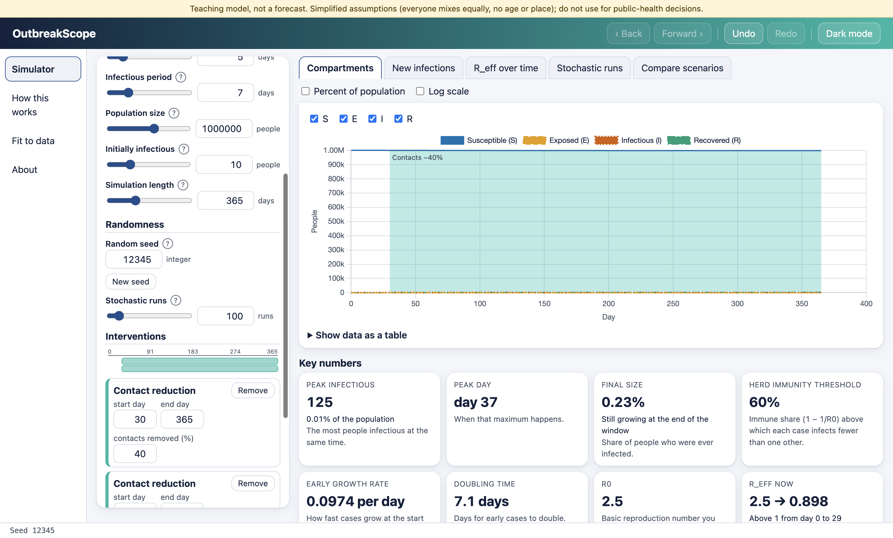
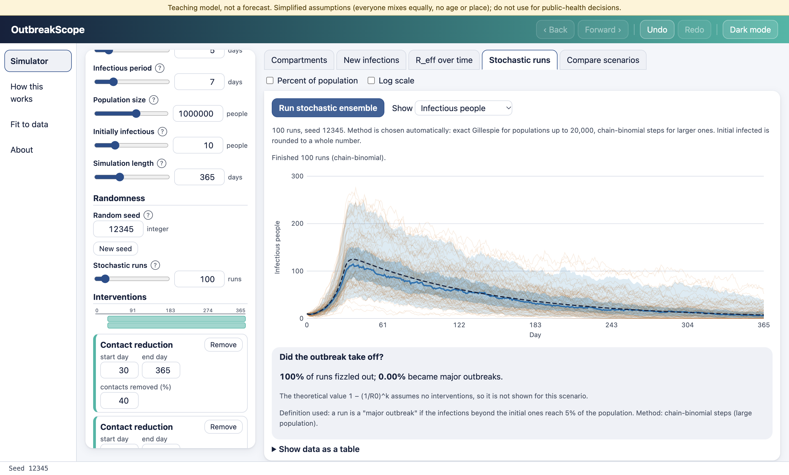
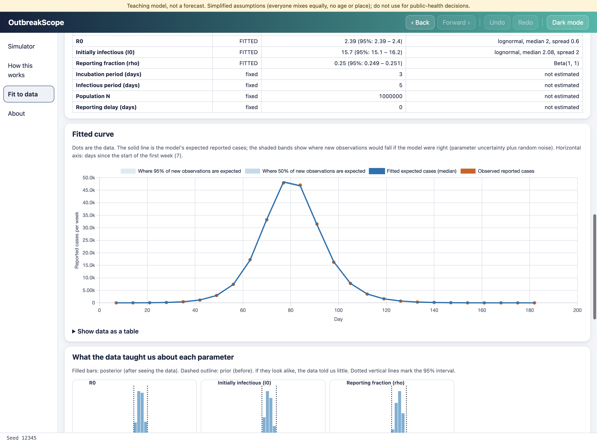

# OutbreakScope

An interactive infectious-disease outbreak simulator for the desktop (Windows, macOS, Linux). Pick a model, set plain-language parameters, add interventions on a timeline, watch the curves update, run stochastic versions to see randomness, and fit the model to real case counts with honest uncertainty. The ODE solver, stochastic simulators, optimiser and sampler are written from scratch in this repo and checked against analytical formulas and SciPy; **the tests are the main story.**

> **Educational use only.** These are simplified teaching models, not forecasts. Do not use them for public-health decisions. Preset values are illustrative values from the literature, not predictions about any current outbreak.

| Scenario mode                                      | Stochastic runs                                      | Fit mode                                               |
| -------------------------------------------------- | ---------------------------------------------------- | ------------------------------------------------------ |
|  |  |  |

More screenshots (light and dark) are in [docs/screenshots](docs/screenshots).

## Download

Installers are on the [Releases page](https://github.com/reeper316099/OutbreakScope/releases) once a version is tagged (see [RELEASING.md](RELEASING.md)): Windows installer and portable `.exe`, macOS `.dmg` (Apple silicon and Intel), Linux `AppImage` and `.deb`, plus `SHA256SUMS`.

**The apps are not code-signed** (see [Unsigned apps](#unsigned-apps)).

## Features

**Milestone A: Scenario mode**

- Models: SIR, SEIR, SEIR with a leaky vaccine. Inputs in R0, days, people. Illustrative presets with sources and ranges.
- Timed interventions (contact reduction, vaccination campaigns) shown as bands on the charts; overlaps have clear rules.
- Compartment curves (counts or percent, log scale, hover values), daily/cumulative new infections, R_eff over time with the R_eff > 1 period shaded, text-table fallbacks for every chart.
- Key numbers: peak and peak day, final size, herd immunity threshold, early growth rate, doubling time, R0, R_eff, total vaccinated.
- Stochastic ensemble in background workers (progress, Cancel): realization lines, median and 50%/95% bands, deterministic curve, and the share of runs that fizzled out next to the theoretical value.
- Save up to three scenarios and overlay them with a differences table ("peak reduced by 42%, delayed by 11 days").
- "How this works": flow diagram, MathML equations filled with your numbers, a worked day-0 example, an interactive RK4 step, and where each assumption breaks.
- Save/open scenario JSON (validated), CSV and PNG export, undo/redo, back/forward between views, light/dark mode, keyboard operable.

**Milestone B: Fit mode**

- Import a CSV (BOM, delimiters, quotes, missing values, unsorted rows, weekly vs daily, bad values all handled and reported, nothing dropped silently) or use a bundled sample or synthetic data.
- Observation model: reported cases = reporting fraction x onsets (optionally delayed). Poisson or negative-binomial likelihood.
- Choose which parameters are fitted and which are fixed; priors are visible and editable.
- Nelder-Mead optimiser with restarts, then 4 Metropolis chains in parallel workers.
- Results: fitted curve with 50%/95% predictive bands over the data, posterior histograms with priors overlaid, R0-vs-reporting scatter, residuals, goodness of fit, identifiability and misfit warnings, R-hat, effective sample size, trace plots, an optional "illustrative projection (not a forecast)".
- A fit that has not converged is labelled **NOT converged** and its numbers are hidden until you ask for them.
- Reported cases are not infections: this is said on every fit.

## Validation (the headline feature)

All numbers are from real runs; details and tolerances are in [MODEL.md](MODEL.md) section 9.

| Check                                                                                                                                 | Result                                                                                                                                  |
| ------------------------------------------------------------------------------------------------------------------------------------- | --------------------------------------------------------------------------------------------------------------------------------------- |
| RK4 vs SciPy (DOP853, rtol 1e-10): 9 reference cases (slow, fast, R0 = 1.05, 1, 0.8, 15, contact reduction, vaccination window, both) | worst error **1.6e-9** of the population (test tolerance 1e-7)                                                                          |
| Three scenarios exported from the app, re-solved by an independent SciPy script (`tools/crosscheck.py`)                               | worst difference **8.1e-10** of the population                                                                                          |
| RK4 convergence order                                                                                                                 | **4.08, 4.04, 4.02** (linear test); 3.79, 3.90 (nonlinear SIR)                                                                          |
| Population conserved, nothing negative (10 regimes incl. R0 = 1, R0 = 15, N = 50, stiff)                                              | within 1e-9 N                                                                                                                           |
| SIR final size vs root of z = 1 - exp(-R0 z)                                                                                          | within 1e-6                                                                                                                             |
| SEIR early growth rate vs eigenvalue formula                                                                                          | within 1e-4 relative                                                                                                                    |
| Chance an outbreak fizzles vs (1/R0)^k (R0 = 2, 1500 runs)                                                                            | 0.502 vs 0.500; 0.249 vs 0.250; 0.489 vs 0.500 (SEIR); 0.496 vs 0.500 (chain-binomial)                                                  |
| Stochastic runs: same seed identical, independent of worker count, mean tracks the ODE                                                | pass (final size within 1.5%)                                                                                                           |
| PRNG (xoshiro128**)                                                                                                                   | known-answer vectors from an independent Python implementation; uniformity chi-square below the p = 0.001 limit                         |
| MCMC on known normals; R-hat/ESS on good and deliberately bad chains                                                                  | pass                                                                                                                                    |
| Parameter recovery, 6 synthetic trials                                                                                                | 95% intervals contained the truth: R0 6/6, I0 6/6, reporting fraction 5/6; all 6 converged (six trials only catch gross miscalibration) |
| Unit tests / coverage                                                                                                                 | **250 passed**; 96.4% statements on `src/sim` and `src/io`                                                                              |
| End-to-end tests (Electron, hidden window, macOS)                                                                                     | **29 passed**, 2 skipped (they need an environment variable)                                                                            |
| Security checks, network, keyboard, contrast                                                                                          | pass (see below)                                                                                                                        |

One finding worth knowing: the peak of _I_ alone is **not** where R_eff = 1 in SEIR; it is the peak of E+I. The original idea ("S/N = 1/R0 at the peak of I") holds for SIR only. The test caught it.

## Run it

Needs Node 22+.

```bash
npm ci
npm run dev          # Electron with hot reload
npm test             # unit tests (Vitest)
npm run test:e2e     # builds, then drives the real Electron app with Playwright (hidden window)
npm run typecheck    # tsc for the renderer, worker, node and test projects
npm run lint
npm run build        # production bundles in out/
npm run dist         # installers for the current OS in dist/
npm run dist:dir     # unpacked app only (fast)
```

Regenerate the SciPy reference fixtures (needs Python with the pinned versions in `tools/requirements.txt`):

```bash
python3 -m pip install -r tools/requirements.txt
npm run ref:generate
```

Run the independent cross-check and the packaged-app test:

```bash
CROSSCHECK_DIR=/tmp/cc npx playwright test tests/e2e/crosscheck.spec.ts && python3 -I tools/crosscheck.py /tmp/cc/*.csv
npm run dist:dir && PACKAGED_APP="$PWD/dist/mac-arm64/OutbreakScope.app/Contents/MacOS/OutbreakScope" npx playwright test tests/e2e/packaged.spec.ts
```

## Unsigned apps

Installers are **not signed or notarized**; signing is on the stretch list. Your system will warn you:

- **Windows (SmartScreen, "Windows protected your PC / unknown publisher"):** click **More info**, then **Run anyway**.
- **macOS (Gatekeeper, "cannot be opened because the developer cannot be verified"):** open the `.dmg`, drag OutbreakScope to Applications, then **right-click the app, choose Open, and click Open** once. If that is not offered: System Settings, Privacy & Security, scroll to the message about OutbreakScope and click **Open Anyway**. Advanced: `xattr -dr com.apple.quarantine /Applications/OutbreakScope.app`.
- **Linux:** make the AppImage executable (`chmod +x OutbreakScope-*.AppImage`) and run it, or install the `.deb`. The Chromium sandbox needs user namespaces; if the AppImage refuses to start on a restricted system, see the Electron docs for the `chrome-sandbox` helper.

## What was tested where

- **macOS (Apple silicon), this machine:** all unit and end-to-end tests ran and passed; the unpacked app and the `.dmg` were built, and the packaged app launched, ran a simulation and completed a small fit (ran and passed). The `.dmg` itself was not installed or mounted.
- **Linux, Windows, and the macOS Intel build: UNTESTED LOCALLY, verified only by CI** (`.github/workflows`). The workflows have not run yet; a first failure there would not be surprising and is fixed by editing the YAML.

## Manual click-through after installing

Launch and check the title; move the R0 slider and watch the chart and key numbers; add a contact reduction and see the band; run the stochastic ensemble, then run it again (identical output) and press Cancel on a long run; save a scenario, quit, relaunch and open it; export a CSV and a PNG; open Fit to data, choose a sample dataset, fit it and read the verdict and warnings; switch to dark mode, quit and relaunch (it should remember).

## Security notes

Electron runs with `contextIsolation: true`, `nodeIntegration: false` and `sandbox: true`. The app is served from a custom `app://` protocol that rejects path traversal, with a strict Content-Security-Policy (`default-src 'self'`, `worker-src 'self'`, `connect-src 'none'`, no `unsafe-*`). The preload exposes exactly four functions (`openFile`, `saveFile`, `openExternal`, `getAppInfo`); every argument is validated again in the main process (zod), file size (5 MB), type and text-only limits are enforced there, and only https links to an allowlist of hosts open in the system browser. New windows and navigation away are blocked, permissions are denied, and every http(s)/ws request is cancelled at the session level. There is no `eval`, no remote code, no backend and no network access at runtime; a unit test scans the source for forbidden APIs, and an end-to-end test records every request during a full click-through. All randomness in simulations comes from a seeded PRNG (the seed is shown and saved in exports); `Math.random` is banned by lint and by a test.

## Limitations

Homogeneous mixing; no age, space or contact structure; constant parameters apart from your interventions; exponential stage durations; permanent immunity; a leaky, instantly effective vaccine. Fit mode fits one wave without interventions and takes the population and reporting delay as fixed inputs. Reported counts are not infections. On the bundled real hospital-admission series the one-wave model fits poorly, and the app says so. More in [MODEL.md](MODEL.md) and the About page.

Fitting results are **not** saved/loaded as sessions (only scenarios are); fits can be exported as CSV.

## Data and sources

Parameter presets and sample datasets, with links, licences and caveats, are in [DATA-SOURCES.md](DATA-SOURCES.md). The two real datasets are public-domain CDC hospital-admission counts for Utah; the third is synthetic and labelled as such.

## Stretch features (ranked by impact / effort)

1. **Code signing, notarization and auto-update** (high impact, medium effort): removes the scary warnings and delivers updates.
2. **A "test-and-isolate" intervention** (high impact, low effort): move detected cases out of I after a delay.
3. **Age-structured contact matrices** (high impact, high effort): the classic next step, needs sourced contact data.
4. **Fetching live open data** through an allowlisted main-process request (medium impact, medium effort): breaks the no-network rule deliberately, so it needs a clear opt-in.
5. **A spatial / metapopulation model** (medium impact, high effort).

## What I learned

TODO: write this section yourself (what surprised you, what you would do differently, what you can now explain in an interview).

## Licence

MIT for the code ([LICENSE](LICENSE)). Data licences and attributions are in [DATA-SOURCES.md](DATA-SOURCES.md) and on the About page.
